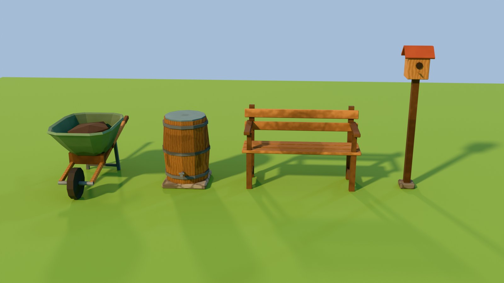

# Yard props, set 1



Built by `story-mode/art-src/blender/build_yard_props_set1.py` (Blender 5.2.3, headless), which reuses the
helpers, palette and paint materials of `build_yard_assets.py`. Shipped as `story-mode/assets/art/yard/props_set1.glb`
(geometry only, meshopt, one named node per prop, origin at base centre, metres) plus one shared 512 baked
colour x AO atlas, `props_set1_atlas.webp` (runtime, same loader path as `props_atlas.webp`), and
`props_set1_atlas.ktx2` (ETC1S + mipmaps, for when the scene moves to KTX2Loader). `yard-art.js` loads the GLB + WebP
atlas exactly like `props.glb` (shared `loadPropKit`), merged into one shadowed mesh `yard-art-props-set1` (+1 draw
call); placements live in `PROP_SET1_PLACEMENTS` (`yard-layout.js`), covered by `yard-art.test.js`.

| Prop | Tris | Source / licence |
|---|---|---|
| wheelbarrow | 508 (rolled lip, flared bowl on cleats, rails from axle to grips, legs + foot bar) | original, procedural (this repo) |
| rain_barrel | 340 | original, procedural (this repo) |
| garden_bench | 404 | original, procedural (this repo) |
| birdhouse | 176 | original, procedural (this repo) |

Every prop is within the style-kit prop budget (30-750 tris, shared 512 atlas, mergeable into 1 draw). No
third-party geometry, textures or logos.

Rebuild:
```
cd story-mode
blender -b --factory-startup -P art-src/blender/build_yard_props_set1.py -- art-src/build [--quick] [--render=/tmp/lineup.png]
node scripts/art/export-and-budget.mjs
toktx --t2 --encode etc1s --clevel 4 --qlevel 200 --genmipmap assets/art/yard/props_set1_atlas.ktx2 art-src/build/props_set1_atlas.png
```
Validator (2.0.0-dev.3.10): 0 errors, 0 warnings. The infos are expected: the meshopt extension isn't supported by
the validator, TEXCOORD_0 is "unused" because the atlas is applied at runtime, not embedded (CSP), and the meshopt fallback buffer is unused.
Don't repack with gltfpack: it drops the TEXCOORD_0 that the external atlas needs.
