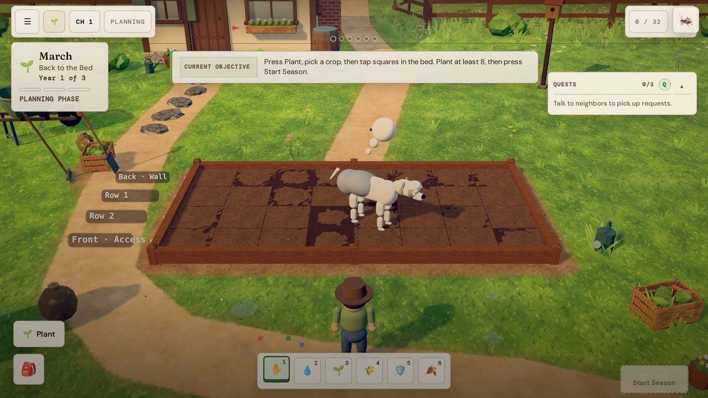
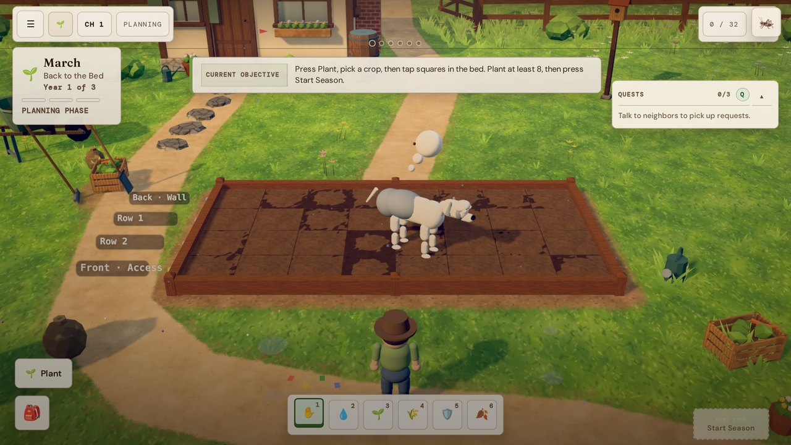
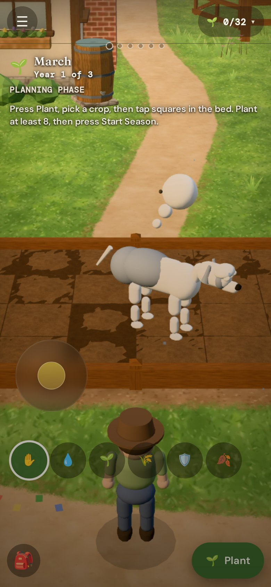
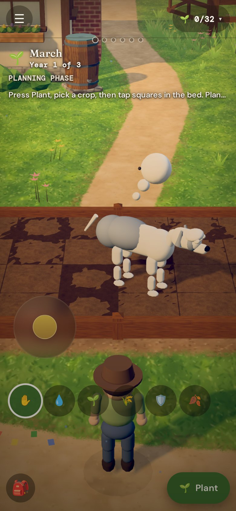
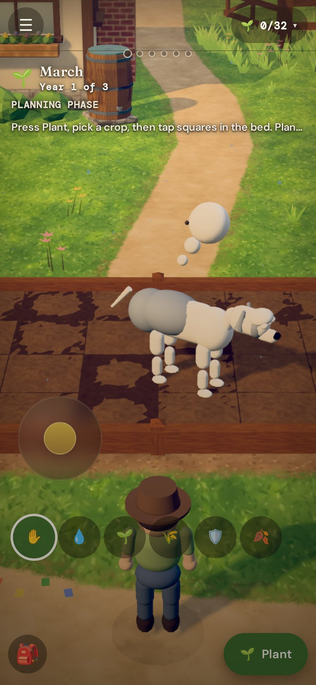

# Story Mode yard perf — 2026-11-25

Local A/B on main `193d862` (before) vs this branch (after). Headless Chromium 149 + SwiftShader, so absolute fps is pessimistic; use the relative change and `renderer.info` as the reliable signals. Same probe, same default Chapter 1 yard view, 5.5 s windows. Numbers are Confirmed for this harness.

| View | Build | Canvas | DPR | fps p50 unthrottled | fps p50 4× CPU | Calls | Tris | shadow.autoUpdate |
|---|---|---:|---:|---:|---:|---:|---:|---|
| Desktop auto (high), 1280×720 CSS, device DPR 2 | before | 2560×1440 | 2 | 0.66 (1523.6 ms) | 0.74 (1343.8 ms) | 156 | 304,472 | true |
| | after | 1920×1080 | 1.5 | 1.45 (691.7 ms) | 1.15 (870.3 ms) | 156 | 273,752 | false |
| Phone auto (low), 390×844 CSS, device DPR 3 | before | 487×1055 | 1.25 | 6.37 (157.0 ms) | 4.96 (201.5 ms) | 125 | 169,154 | true |
| | after | 487×1055 | 1.25 | 6.99 (143.1 ms) | 6.20 (161.3 ms) | 125 | 138,434 | false |
| Phone `?quality=high` | before | 780×1688 | 2 | 2.12 (471.6 ms) | 1.40 (712.2 ms) | 126 | 300,943 | true |
| | after | 585×1266 | 1.5 | 2.32 (431.0 ms) | 2.69 (371.2 ms) | 126 | 270,223 | false |

Triangle drop is 30,720 in every view (128×128 ground → 32×32). Draw-call count is unchanged. Desktop unthrottled mean fps went from 1.01 to 2.14 in the same window (p50 is noisy at ~1 fps because a 5.5 s sample has few frames).

Auto still picks only high or low. Mid is a manual Graphics / `?quality=mid` choice.

## Same-view screenshots

Desktop auto (high):

Phone auto (low):

Phone forced high:

